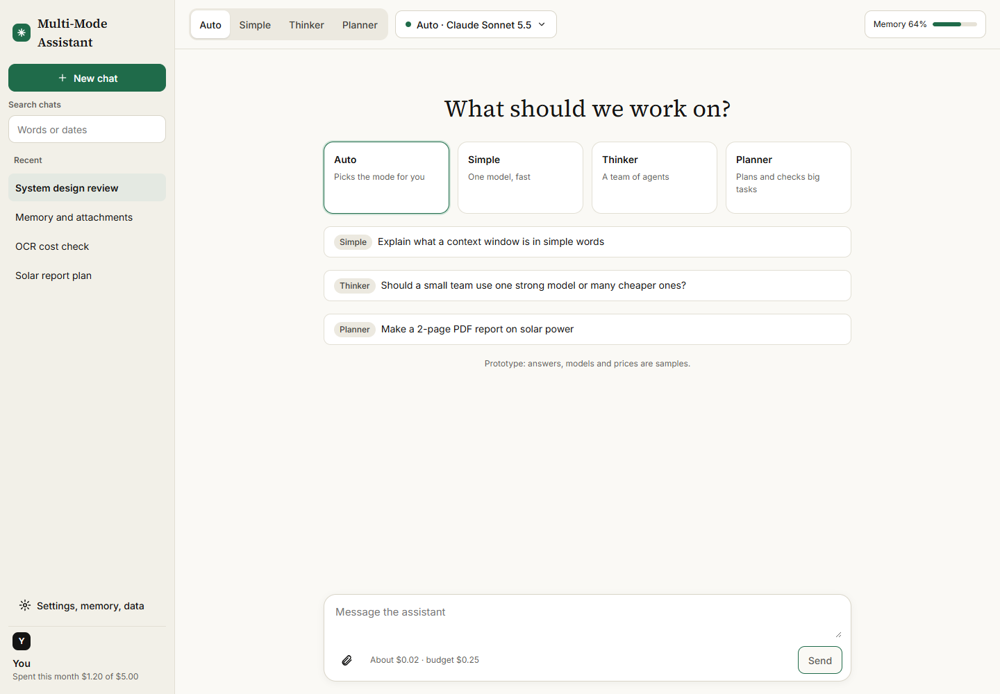
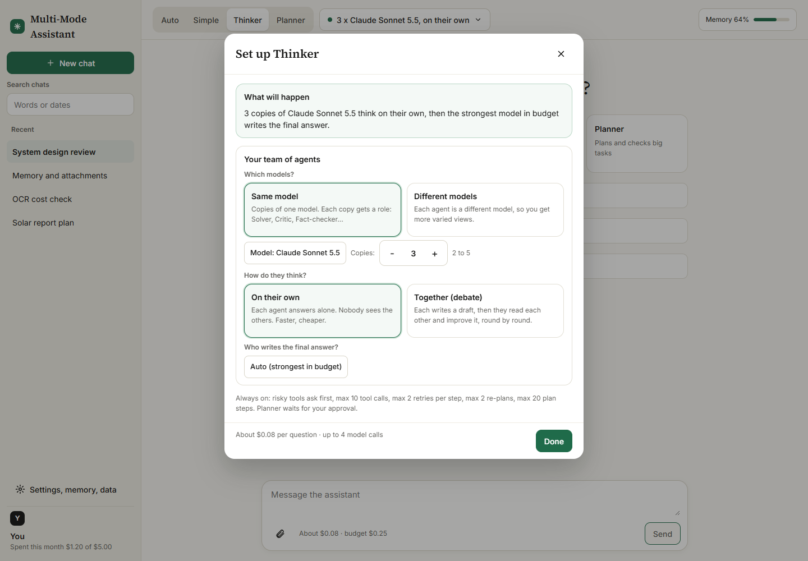
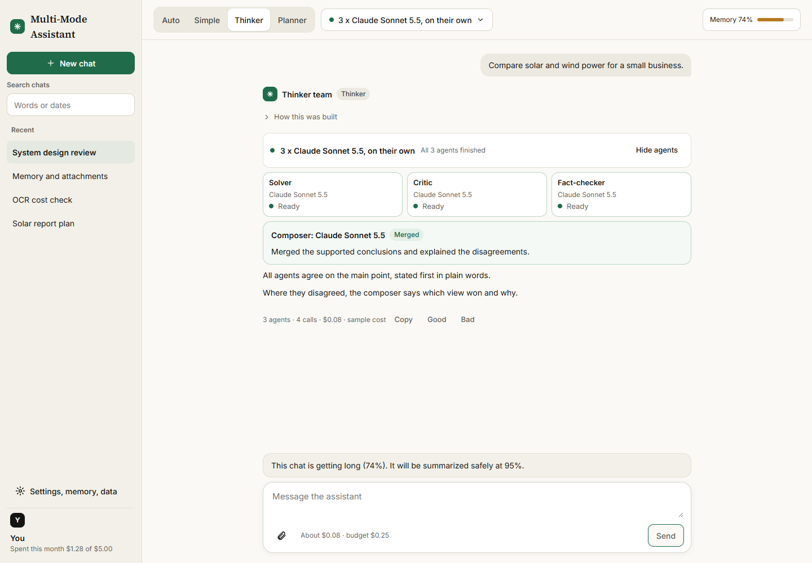
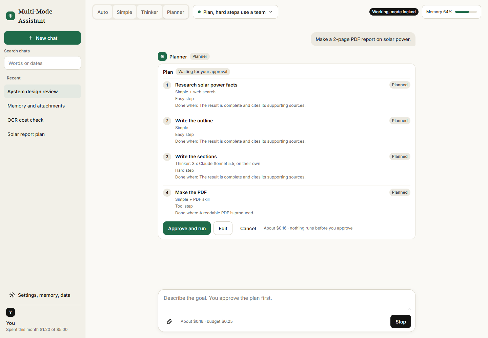
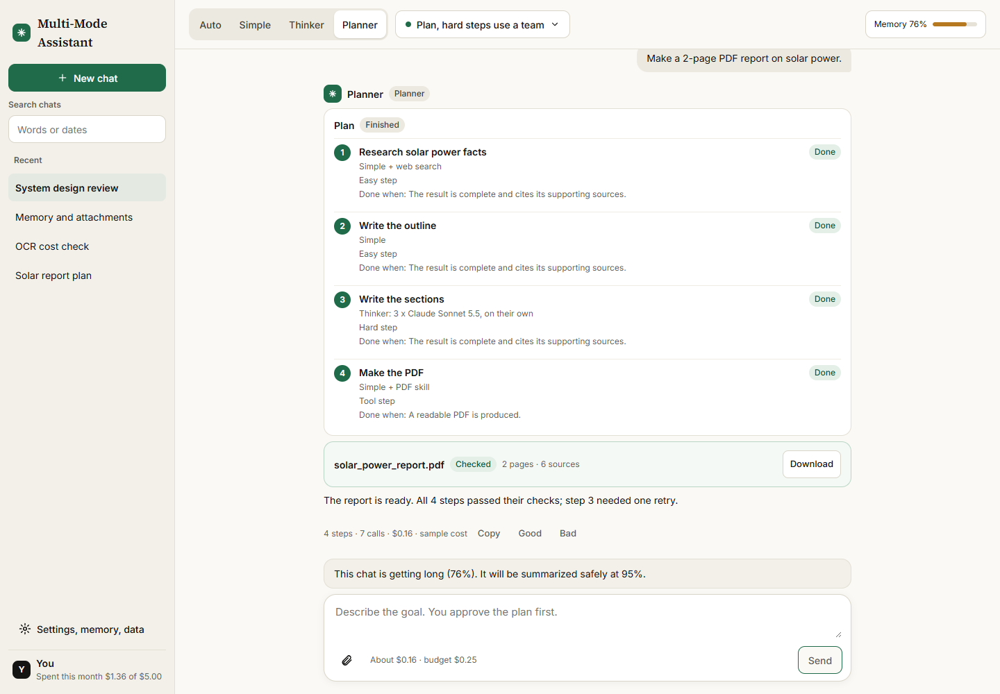
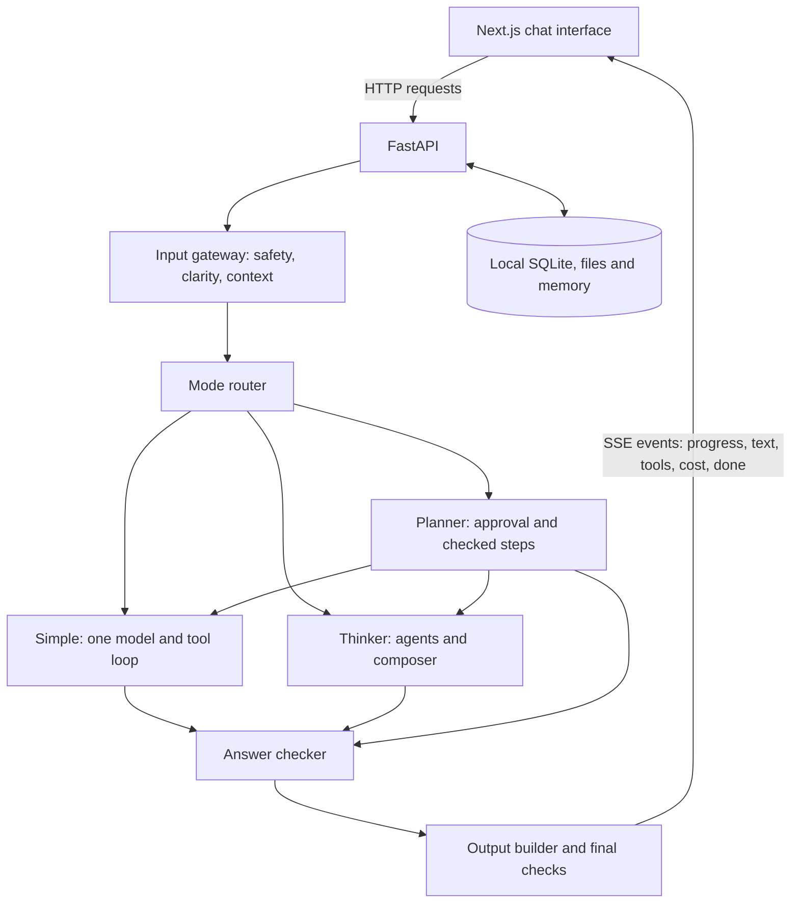

# Multi-Mode AI Assistant

An AI workspace with **Simple**, **Thinker** and **Planner** modes. You choose the mode and the model, set a question budget, attach documents and watch the work progress in one chat interface.

**Next.js + React frontend | FastAPI + Python backend | OpenRouter / NVIDIA model access**

[Quick start](#quick-start) | [Screenshots](#screenshots) | [How it works](#how-it-works) | [Code guide](#code-guide) | [Tests](#tests-and-verification)



## What the app does

| Mode | Behavior | Example request |
|---|---|---|
| **Simple** | One model answers with your chosen thinking level, answer length and enabled tools. | ?Explain context windows with an example.? |
| **Thinker** | Two to five agents answer independently or debate; a composer merges their answers. | ?Compare solar and wind power for a small business.? |
| **Planner** | Produces a plan for approval, runs dependent steps, checks the results and builds the final output. | ?Make a two-page PDF report on solar power.? |

Shared features include per-question budgets, usage logs, model capability filtering, permission prompts, document reading, checked outputs, searchable chat history, memory controls and ZIP export/import.

The current design is [specification v3](Multi-Mode_AI_Assistant_Complete_Spec_v3.pdf), including the [model, prompt and cost addendum](spec-audit/SPEC-ADDENDUM.md) and the [v3 flow, safety, memory and file addendum](spec-audit/SPEC-ADDENDUM-v3.md). The original specification and the v2 PDF are also included.

## Repository branches

| Branch | Contents |
|---|---|
| **[`main`](https://github.com/TalhaFaredi/Claude_Style_Multi_models_Thinker_Agent/tree/main)** | **Complete application:** frontend, backend, setup instructions and screenshots. Start here. |
| [`backend`](https://github.com/TalhaFaredi/Claude_Style_Multi_models_Thinker_Agent/tree/backend) | Separate backend source snapshot. |
| [`frontend`](https://github.com/TalhaFaredi/Claude_Style_Multi_models_Thinker_Agent/tree/frontend) | Separate frontend source snapshot. |

The component branches are separate snapshots; commits to `main` do not automatically update them.

## Quick start

### 1. Clone the complete app

Use Python 3.11+ and Node.js 20+. Docker is optional and needed only for the code sandbox.

```bash
git clone https://github.com/TalhaFaredi/Claude_Style_Multi_models_Thinker_Agent.git
cd Claude_Style_Multi_models_Thinker_Agent
```

### 2. Configure the backend

Copy [.env.example](.env.example) to `.env` in the repository root. Add your own OpenRouter key. NVIDIA is optional.

```dotenv
# Root .env ? backend only
OPENROUTER_API_KEY=your_openrouter_key
NVIDIA_API_KEY=
```

Real `.env` files are ignored by Git. Provider keys stay on the server and must never be put in `NEXT_PUBLIC_*` variables.

**Windows / PowerShell:**

```powershell
Copy-Item .env.example .env
# Edit .env and set OPENROUTER_API_KEY before starting the backend.
cd backend
python -m venv .venv
.\.venv\Scripts\python.exe -m pip install -r requirements.txt
.\.venv\Scripts\python.exe -m uvicorn app.main:app --host 127.0.0.1 --port 8000
```

**macOS / Linux:**

```bash
cp .env.example .env
# Edit .env and set OPENROUTER_API_KEY before starting the backend.
cd backend
python3 -m venv .venv
.venv/bin/python -m pip install -r requirements.txt
.venv/bin/python -m uvicorn app.main:app --host 127.0.0.1 --port 8000
```

Keep this terminal running. The API is at **http://127.0.0.1:8000**, and interactive API documentation is at **http://127.0.0.1:8000/docs**.

### 3. Start the frontend

Open a **second terminal** in the repository root:

```bash
cd frontend
npm ci
```

Create `frontend/.env.local` with:

```dotenv
NEXT_PUBLIC_API_URL=http://localhost:8000
```

Then start the UI:

```bash
npm run dev:webpack
```

Open **http://localhost:3000**. Choose a mode, open **Setup**, pick an available model, review the budget and send a message. Planner pauses until you approve its plan.

For a production frontend, set the API URL **before building**, then run:

```bash
npm run build:webpack
npm start
```

After first-time installation and configuration, Windows users can start both services from the root with `powershell -ExecutionPolicy Bypass -File scripts/dev.ps1`.

### Try the interface without a provider

Leave `NEXT_PUBLIC_API_URL` unset or empty and restart the frontend. It uses a scripted offline demo: no backend or provider key is needed. Demo answers, model names, files and prices are examples; real inference requires the connected backend.

## Screenshots

These screenshots were captured from the running application's **offline demo**, using fresh browser sessions. They show actual UI components; sample answers, model names, costs and output cards are illustrative.

### Configure a Thinker team

Choose copies of one model or a mix, agent count, independent/debate style and the composer.



### Inspect the agents and composed answer

Agent cards show progress, and the composer card explains the merge.



### Review a plan before running it

The plan shows tasks, step types and done-tests. Approve, edit or cancel before execution.



### Follow steps through to the output

Step states, checker retries and the final output card remain visible in the conversation.



To regenerate these images without paid model calls, see [docs/screenshots/README.md](docs/screenshots/README.md).

## How it works



The backend owns model calls and execution decisions. The frontend displays typed progress events and sends explicit controls such as plan approval, Stop and tool permission. All modes use the shared cost meter, tools, checker and output builders.

**Models and prompts.** The model picker lists the complete loaded OpenRouter catalog plus configured NVIDIA entries, with search, provider, capabilities and availability reasons. A prompt viewer shows the shipped system and agent-role templates, including each Thinker role, Planner, router and Checker. The templates contain literal placeholders; private runtime messages and documents are not included.

**Thinking and cost.** Provider-exposed reasoning notes appear with the model and agent/stage that produced them. Models that do not supply notes show that state without invented reasoning. Calls reserve spending before dispatch; agents, retries, retrieval and memory work share the approved question cap. After each model call, the UI shows its recorded tokens and USD, with estimated charges marked. The model picker also shows tentative **single-call** ranges for small (1k-5k tokens), medium (5k-50k) and high (50k-500k) tasks using 70% input and 30% output; these omit reasoning, tools, retries and other calls. The question-specific estimate and approved cap govern the run.

**Files.** Fingerprints and reader/version caches reuse saved readings. Direct text extraction is local; paid OCR/vision reading shows its estimate and approved maximum first. Readers support PDFs, images and Office files, with tables, chart descriptions and page citations.

### Uploaded PDFs and images, simply explained

1. **Upload and inspect:** the original is saved locally under `backend/data/`, checked for duplicate content and inspected without a paid model call. The upload limit is 25 MB per file.
2. **Read the content:** the reader depends on the page type:

   | Content | What happens |
   |---|---|
   | Normal PDF text and tables | Text is extracted locally for free; the layout parser preserves table cells. |
   | Scanned PDF or uploaded image | OCR (text recognition) extracts readable text. Auto tries local OCR first; configured API/vision readers can also transcribe text. |
   | Detected PDF chart or diagram | With chart descriptions enabled, a vision model describes the rendered page; its image can also be retained. |

3. **Review the cost:** choose the reader/pages and approve the displayed maximum before paid reading. Paid readers send the selected page images to their provider. **Text only** is free but cannot read scans or explain charts.
4. **Ask questions:** the app saves a Document Card and searchable chunks. It sends the full extracted content when it fits, or retrieves relevant parts for the answer with file/page references.
5. **Reuse the reading:** the same file, reader and parser version reuse cached pages without another reading charge. Answering questions still uses model tokens; optional meaning-search indexing can also cost money.

**Image limitation:** uploaded images currently follow the text-transcription path. They do not automatically receive a general photo/scene description. Unreadable pages are marked as weak rather than treated as successfully read.

**Memory.** Original messages stay in the archive. Context alarms expose summarizing and continuation controls; checked compaction preserves critical details. Export/import can retain messages, facts and cached file readings, with optional password protection.

**Outputs.** Text, Markdown, PDF, PNG, static HTML and code share final checks. Failed checks are shown; an unchecked file must not be presented as checked.

## Code guide

```text
.
|-- .env.example                # Server configuration template; no real keys
|-- backend/
|   |-- app/
|   |   |-- main.py             # FastAPI startup and route registration
|   |   |-- api/                # HTTP/SSE endpoints and request schemas
|   |   |-- pipeline/           # Gateway, router, run lifecycle and checker
|   |   |-- modes/              # Simple, Thinker and Planner implementations
|   |   |-- llm/                # Provider client, retries and model registry
|   |   |-- core/               # Config, SQLite, cost meter and privacy
|   |   |-- files/              # Reading, OCR, caching and retrieval
|   |   |-- memory/             # Archive, facts, context and portability
|   |   |-- tools/              # Search, calculator, file search and sandbox
|   |   |-- output/             # Artifact builders and final validation
|   |   |-- prompts/            # Prompt templates
|   |   |-- skills/             # App-loaded instruction files
|   |-- tests/                  # Offline regressions and opt-in live gates
|   |-- requirements.txt
|-- frontend/
|   |-- src/app/                # Next.js entry point and bundled fonts
|   |-- src/components/         # Chat blocks, layout, dialogs and settings
|   |-- src/domain/             # Shared UI types, limits and event reducer
|   |-- src/services/           # API client, SSE and offline demo runners
|   |-- src/store/              # Zustand state
|   |-- src/styles/             # Design tokens and responsive CSS
|   |-- tests/                  # Unit and transport tests
|   |-- e2e/                    # Browser checks and screenshot capture
|-- docker-compose.yml, Caddyfile, .env.production.example, DEPLOYMENT.md   # production deployment
|-- scripts/dev.ps1             # Windows launcher for both services
|-- docs/screenshots/           # README images and reproduction steps
|-- spec-audit/                 # Selected implementation/verification reports
```

Follow a request through these files:

1. [Composer.tsx](frontend/src/components/layout/Composer.tsx) collects the message. [chatStore.ts](frontend/src/store/chatStore.ts) prepares configuration and budget controls.
2. [sseRunner.ts](frontend/src/services/runner/sseRunner.ts) sends the run and reads progress events from [api/runs.py](backend/app/api/runs.py).
3. [pipeline/engine.py](backend/app/pipeline/engine.py) manages the run. [gateway.py](backend/app/pipeline/gateway.py) and [router.py](backend/app/pipeline/router.py) assess the input and choose the workflow.
4. [modes/simple](backend/app/modes/simple), [modes/thinker](backend/app/modes/thinker) or [modes/planner](backend/app/modes/planner) execute it through the shared [LLM client](backend/app/llm/client.py).
5. [checker.py](backend/app/pipeline/checker.py) evaluates results. [output/](backend/app/output) builds and validates artifacts.
6. [reduceRunEvent.ts](frontend/src/domain/reduceRunEvent.ts) updates the displayed answer, steps, tools and costs.

For the old flat-module names, model access now lives in `backend/app/llm/`, database access in `backend/app/core/db.py` and budget accounting in `backend/app/core/costmeter.py`.

### Useful API endpoints

| Endpoint | Purpose |
|---|---|
| `GET /health` | Service health |
| `GET /api/config` | Defaults and available capabilities |
| `GET /api/models` | Model registry, capabilities, prices and availability |
| `GET /api/prompts` | Reviewable static prompt templates and their role labels |
| `POST /api/estimate` | Estimate a proposed run |
| `POST /api/runs` | Start a run and stream SSE events |
| `POST /api/runs/{id}/approve` | Approve the displayed plan version |
| `POST /api/runs/{id}/permission` | Allow or deny one tool action |
| `POST /api/runs/{id}/stop` | Stop and settle run accounting |
| `GET /api/usage` | Recorded usage and reading spend |

A read-only API example, with no inference call:

```python
import httpx

base_url = "http://127.0.0.1:8000"
response = httpx.get(f"{base_url}/api/config", timeout=10)
response.raise_for_status()
print(response.json())
```

Request/response schemas and runnable examples are available in `/docs`. See [backend/README.md](backend/README.md) and [frontend/README.md](frontend/README.md) for component-specific details.

## Tests and verification

**Offline backend tests - no provider credits:**

```powershell
cd backend
.\.venv\Scripts\python.exe -m pytest -q -p no:cacheprovider
```

On macOS/Linux, use `.venv/bin/python` instead of `.\.venv\Scripts\python.exe`.

**Frontend checks:**

```bash
cd frontend
npm test
npm run typecheck
npm run build:webpack
```

The deterministic browser gate starts its own API/SSE fixture and Next server. Build the matching fixture version first; PowerShell example:

```powershell
cd frontend
$env:NEXT_PUBLIC_API_URL='http://127.0.0.1:8487'
$env:NEXT_BUILD_DIR='.next-spec-live'
npm run build:webpack
npm run test:spec
```

Use a new terminal afterward for normal builds so those fixture environment variables are not reused.

**Recorded verification, November 10, 2026:**

| Check | Saved result |
|---|---|
| Backend regression tests | 108 passed |
| Frontend unit/transport tests | 36 passed |
| Browser specification checks | 25/25 passed |
| Production build | Passed |
| Live mode/comparison/routing questions | 33/33 correct |
| Live generated-PDF table/chart fixtures | 20/20, with correct page citations |
| Live planted-fact recall | 50/50 after compaction and 50/50 after import |

The live fixtures are controlled tests. They do not establish correctness for arbitrary questions or real-world scans. On the measured comparison set, teams did not outperform Simple. See the [implementation matrix and limits](spec-audit/IMPLEMENTATION.md) and its linked reports.

Live acceptance scripts in `backend/tests/live_*acceptance.py` make no requests by default. Real inference requires `--live` and uses explicit aggregate spending caps; it consumes your provider credits.

## Configuration and troubleshooting

| Situation | What to check |
|---|---|
| You see sample answers | `NEXT_PUBLIC_API_URL` is missing/empty. Set it in `frontend/.env.local`, then restart or rebuild. |
| Backend cannot be reached | Check port 8000, the frontend API URL and `CORS_ORIGINS`. |
| No usable provider/model | Check server-side credentials, provider availability and known pricing in `/api/models`. |
| NVIDIA models are disabled | Configure your actual `NVIDIA_INPUT_USD_PER_MILLION` and `NVIDIA_OUTPUT_USD_PER_MILLION`; availability is account-dependent. |
| Code sandbox is disabled | Install/run Docker's Linux engine and pull `python:3.12-alpine`, then restart the backend. No host-code fallback is used. |
| A selected model cannot use tools/images/thinking | Choose a compatible model; the picker explains capability restrictions. |

The backend stores databases, originals and generated files under `backend/data/` by default (set `DATA_DIR` to move it); this directory is ignored by Git.

## Accounts and running it for other people

The app is **multi-user by default**: every visitor signs up or signs in, and each account's chats, files, memories, settings and spending are private to it. The landing page is `/`, the assistant is at `/app`, and there are sign-in, password reset, account and admin pages.

| You want | Do this |
|---|---|
| **Run it publicly** (website, HTTPS, many users, spending caps, backups) | Follow **[DEPLOYMENT.md](DEPLOYMENT.md)**: `docker compose up -d --build` after filling in `.env` from [.env.production.example](.env.production.example). |
| **Try it locally with accounts** | Start both services as above, open http://localhost:3000 and create an account. The first account whose e-mail is in `ADMIN_EMAILS` becomes an administrator. |
| **Use it alone on your own machine without any login** | Put `AUTH_REQUIRED=0` in the root `.env`. The API is then open and single-user, so keep it bound to `127.0.0.1`. The server refuses this setting in production. |
| **Keep data you created before accounts existed** | `python -m app.admin adopt-legacy you@example.com` (inside `backend/`) hands the old single-user data to an account. |

Operator tools (inside `backend/`): `python -m app.admin` creates users, resets passwords, sets monthly allowances and disables accounts; `python -m app.backup` writes consistent database backups. Both are explained in [DEPLOYMENT.md](DEPLOYMENT.md).

## License

No project-wide license has been selected. Bundled fonts retain their upstream license notices in [frontend/src/app/fonts/](frontend/src/app/fonts/).
